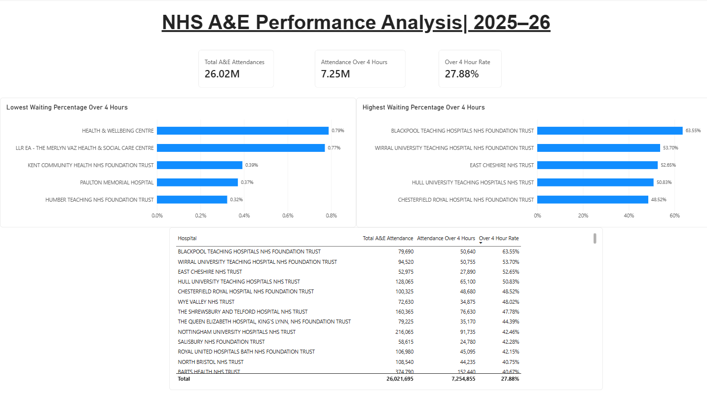

# NHS A&E Waiting Times Analysis (2025/26)

## Project Overview

This is my first SQL and Power BI portfolio project, analysing NHS A&E attendance durations during 2025/26.

The aim was to investigate differences between NHS providers in the percentage of attendances lasting longer than four hours, while developing my practical SQL and Power BI skills.

I used SQL to prepare and analyse the original NHS dataset before creating an interactive Power BI dashboard to visualise the results.

## Tools and Skills Used

**SQL**
- Common Table Expressions (CTEs)
- CASE WHEN statements
- SUM() and GROUP BY
- Data filtering and handling suppressed values
- Percentage calculations and sorting

**Power BI**
- Data visualisation
- DAX measures using SUM() and DIVIDE()
- KPI cards
- Top-five and bottom-five provider comparisons

## Dashboard

The dashboard contains three KPI cards showing total attendances, attendances over four hours and the overall percentage. It also compares the five highest and lowest provider percentages and includes a table of the processed data.

## Key Findings

My final processed dataset included 172 NHS providers.

- Total attendances: **26,021,695**
- Attendances exceeding four hours: **7,254,855**
- Overall percentage: **27.88%**
- Highest provider percentage: **63.55%**
- Lowest provider percentage: **0.32%**

The results demonstrate considerable differences between NHS providers, although variations in the services they provide mean these percentages should not automatically be interpreted as differences in healthcare quality.

## Data Source

NHS England — *Hospital Accident & Emergency Activity, 2025–26*, ECDS Provider Level Analysis.

https://digital.nhs.uk/data-and-information/publications/statistical/hospital-accident--emergency-activity/2025-26

## Project Limitations

Providers containing suppressed values (*) in the selected measurements were excluded from the final analysis. The results therefore represent a filtered dataset rather than national NHS totals.

NHS England's headline statistics use a different data source, so differences between the published national figures and this project are expected.

## Repository Files

- `SQL NHS lowest 10.sql` — SQL query used for the analysis.
- `Waiting Time in NHS Bottom to Top as %.csv` — Processed SQL results.
- `NHS AE Performance Analysis.pbix` — Power BI dashboard.
- `NHS_AE_Dashboard.png` — Dashboard screenshot.
- `Project Overview.pdf` — Full project report, including methodology, findings and limitations.

## Future Improvements

In future projects, I would like to explore more advanced SQL techniques, investigate changes over time and compare NHS providers with similar healthcare services.
